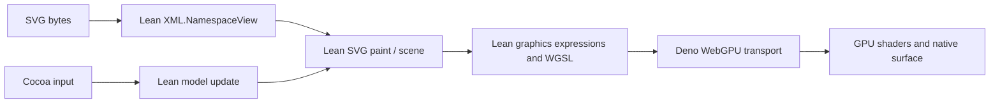

# Foafnaut: Lean graphics on a native WebGPU host

The source experiment now lives in
[`labs/demos/foafnaut`](../../labs/demos/foafnaut/README.md). The owner requested
this location and separate executable artifacts in factoidal-builds on
2026-10-30. It is a browser research lab, separate from the shipped npm engine.
SVG coverage work is tracked in
https://github.com/danbri/factoidal/issues/1209.

## What runs

The lab contains a spring network, responsive selectable cards, a vector
playground, a generated still image and an SVG-file renderer. The Mac executable
contains Deno and the small Lean WASM modules. This is an Emscripten ABI hosted
by Deno, not a WASI component, wasi:webgpu implementation, native extraction-only
Lean executable, or browser webview. A future WASI host can preserve the division
of responsibilities without claiming ABI compatibility with these artifacts.

Lean owns graphics expressions, WGSL generation, geometry, selection/drag
state, physics, responsive layout and the SVG interpretation. The TypeScript
host transports events, scene buffers, shader source and GPU results. Cocoa
provides the window, native surface handles and input. WebGPU provides device,
buffer, pipeline and presentation operations; it does not supply an SVG parser
or high-level path/fill API.

Interactive modes retain their GPU device, pipeline and buffers. Lean emits
shader code once and supplies subsequent model/data/command changes. The host
delivers timers and input through a manual event loop on the OS main thread.
There is no general JavaScript engine, DOM, WebIDL, text shaping or CSS layout
in this lab. A future scripting layer needs an explicit event/effect boundary;
it must not silently acquire authority over the host filesystem or window loop.

## Reproducible source and releases

The small build freshly compiles the five XML modules in the current source
closure and the four lab modules. It can reuse pinned Lean runtime/Init/Std
objects. `L4_WASM_RUNTIME_ONLY=1` in `formal/lean4/Wasm/build-wasm.sh` prepares
that cache without building the full library or installing shipped WASM assets.
The default build path is unchanged. All generated outputs stay under ignored
`.build/`; generated binaries, WASM, C, objects and runtime caches are not source.

The companion factoidal-builds change adds the optional
`foafnaut-darwin-arm64` artifact set to the normal core-commit build process.
Linux builds/tests the small engines; macOS ARM64 packages three executables
and the Cocoa sidecar, then checks them after relocation. The set is gated
independently from existing core sets, with source commit, toolchains and file
hashes in `build-info.json`. Only main commits publish. Older core commits
without this lab retain their existing three-set requirement.

The release is a directory, not one executable: its UI binary needs the
adjacent native library. Launchers change into that directory. Deno's narrow
relative library permission survives relocation, including spaces in paths.
The pathless permission required by the native surface is requested while
Terminal still has focus, before a window is created. Declining creates no
window. The released executables need no preinstalled Node, Deno or Lean.

## Measurements and limits

The local warm build passed 40 Deno tests and 12 portable C coordinate checks.
These are local regression checks, not SVG conformance. Compiled CPU/loader
checks and a relocation probe passed without requesting a GPU. The cold
runtime-only bootstrap and Linux path still need execution in CI.

The development UI was exercised on the owner's Apple M1. Recorded traces
show selection and captured dragging in springs/vectors, and card selection
including after resize. The prior failure came from using Cocoa's signed
backing-point conversion in a flipped view: an inside point received negative
Y. The corrected bridge scales normalized view coordinates into top-left
framebuffer coordinates and preserves signed outside points. Replays cover
the observed failure. Surface setup supplies both NSWindow and NSView handles,
flushes Core Animation transactions and defers acquisition while occluded.

The owner confirmed the SVG gallery on the M1 on 2026-10-30: nine primitives,
200 Float uniforms, 640 by 420 pixels and six Lean-reference GPU sample checks.
The measured development SVG executable SHA-256 was
`037c77d5ddd3a01611eee627b80958cb64cba06281c9303515f1559d334dba3d`.
This observation applies to that development artifact; a rebuilt release needs
its own desktop smoke check. Tool execution here has no usable GPU adapter.

The initial SVG profile is documented in
[`SVG_README.md`](../../labs/demos/foafnaut/SVG_README.md).
Unsupported input is refused explicitly. CPU Float evaluation versus GPU f32
sample checks are empirical evidence, not a theorem about raster equivalence,
driver correctness, or complete SVG semantics. The small row-width theorem in
`Graphics.lean` proves a data-layout property only.

[`tests/external/svg`](../../tests/external/svg/README.md) pins complete
standalone SVG reftest categories from WPT: 38 tests and their references,
75 unchanged upstream files with licenses and hashes. Another 54 HTML tests
are inventoried separately. No metadata stripping or feature-based exclusion
reduces the selected denominator. Initial result: **38 unsupported, zero
visual matches**. Missing engines produce 38 unavailable. Fixture-integrity
CI does not count as rendering conformance; a real render run compares every
pixel using the upstream relation/tolerances and reports every non-pass.
