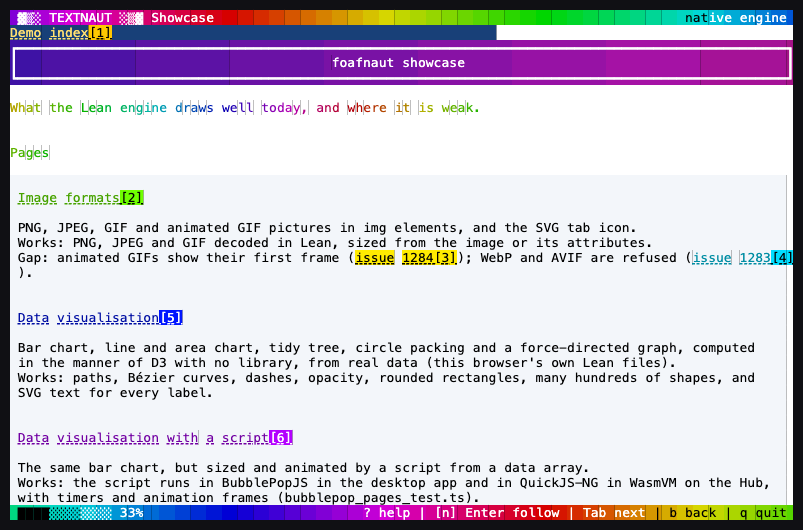
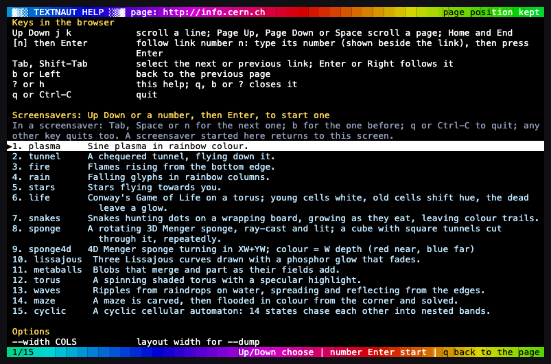
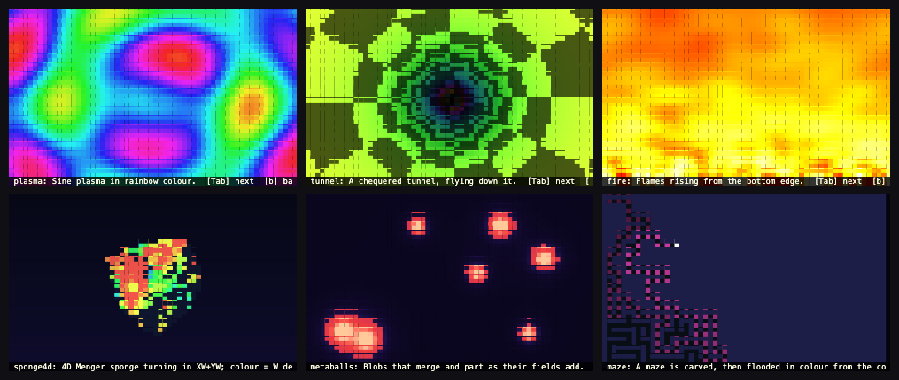

# @foafos/textnaut

> ⚠️ **EXPERIMENTAL UNDER-REVIEWED CODE - USE WITH CARE - DO NOT CREATE PUBLIC SERVICES USING THIS WITHOUT CAREFUL INDEPENDENT EXPERT REVIEW.**

A web browser for the terminal, on the Foafnaut engine. Needs Node 18 or later. Uses your [Deno](https://deno.com) if you have one; otherwise it fetches Deno once.

    npx -y @foafos/textnaut https://info.cern.ch/

Or install it: `npm install -g @foafos/textnaut`, then:

    textnaut                     # a start page with links to try
    textnaut info.cern.ch        # a bare name opens https://, with a note
    textnaut --dump --width 80 page.html
    textnaut --screensaver

## Engine

Textnaut uses the native engine when it is installed. Otherwise it downloads the Wasm engine once (11.7 MB, checked by SHA-256).

- Linux (x86_64): `textnaut --install-native` downloads the native engine once, checks it by SHA-256 and keeps it in `~/.foafnaut` (or `$FOAFNAUT_HOME`); from then on Textnaut uses it. It needs only glibc, no other install. This package pins the release; `--install-native latest` takes the newest self-contained release instead, checked against that release's own build-info.
- macOS (Apple silicon): the native engine comes with the foafnaut app (`npx -p @factoidal/core foafnaut --update`).

`--engine FILE` (or `TEXTNAUT_NATIVE=FILE`) uses a given library. `--wasm` forces Wasm. `--timing` shows which engine ran and how long each step took.

## Changes

- 0.1.4: pins the native Linux x86_64 engine, so `textnaut --install-native` installs a release checked against this package, and moves the Wasm pin to the same engine commit. 0.1.3 could no longer fetch its Wasm engine: the release it pinned was rebuilt, and its download no longer matched the pinned SHA-256 (Textnaut refused it, as it should). Releases are no longer replaced.
- 0.1.3: the engine of 0.37.0; the package carries all the host sources it needs.

## Keys

Arrows, `j`, `k`, Page Up, Page Down, Space: scroll. Number then Enter: follow a link. Tab, Enter: select and follow a link. `b`: back. `?`: help. `q`: quit.

## Licence

Apache-2.0. See `NOTICE` for the engine components.
