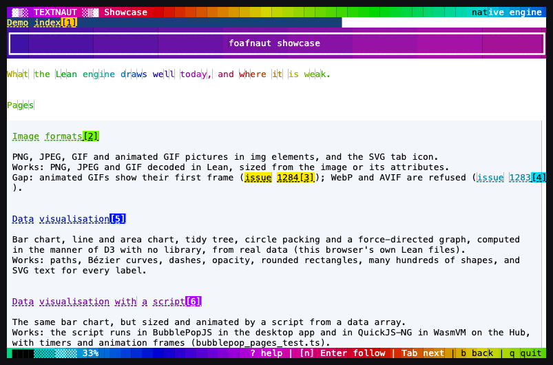
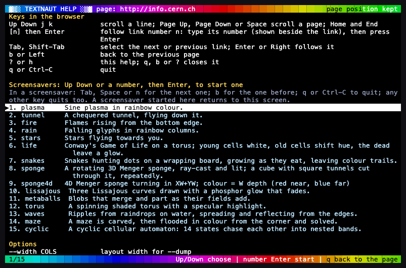
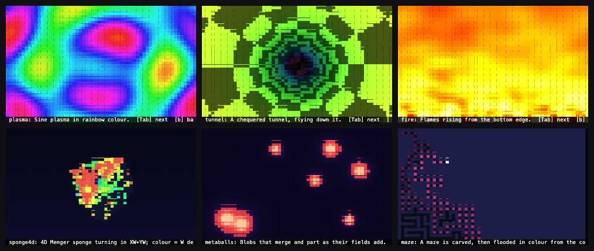

# @foafos/textnaut

> ⚠️ **EXPERIMENTAL UNDER-REVIEWED CODE - USE WITH CARE - DO NOT CREATE PUBLIC SERVICES USING THIS WITHOUT CAREFUL INDEPENDENT EXPERT REVIEW.**

A web browser for the terminal, on the Foafnaut engine. Needs [Deno](https://deno.com) 2 or later and Node 18 or later.

    npx -y @foafos/textnaut https://info.cern.ch/

Or install it: `npm install -g @foafos/textnaut`, then:

    textnaut https://info.cern.ch/
    textnaut --dump --width 80 page.html
    textnaut --screensaver

## Engine

Textnaut uses the native engine if foafnaut is installed. Otherwise it downloads the Wasm engine once (8.1 MB, checked by SHA-256). The native engine is for macOS on Apple silicon only.

`--wasm` forces Wasm. `--timing` shows which engine ran.

## Keys

Arrows, `j`, `k`, Page Up, Page Down, Space: scroll. Number then Enter: follow a link. Tab, Enter: select and follow a link. `b`: back. `?`: help. `q`: quit.

## Licence

Apache-2.0. See `NOTICE` for the engine components.
